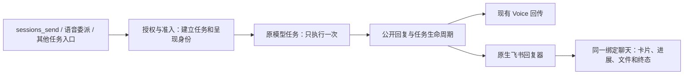

# 绑定飞书 session 的后台模型任务统一展示方案

日期：2026-10-26。状态：方案与代码入口调查，尚未实现或部署。

设计 worktree 基线：`4adc5e3145d0696bb02c4a6bcb532f30ea1766fb`。既有跨 session 候选已独立保存为 [Draft PR #482](https://github.com/vegekyd-sys/v-openclaw-platform/pull/482)，未合入；新方案不把该 PR 的历史验收当作本功能验收。

## 1. 用户得到什么

一个绑定飞书的 session 接到后台模型任务后，无论来自跨会话派活、语音后台委派或其他已授权入口，都能在对应飞书聊天看到任务来源、原生回复卡、公开进展、后台工作状态、最终结果及文件。语音端继续接收同一次任务的结果。

用户无需另外要求“同步飞书”，也不需要进入群里补一句“开始”。飞书已经展示的正常消息不再产生第二套卡片。

**用户已确认范围（2026-10-26）**：仅展示交给 session 后台模型的任务请求、公开过程和最终结果（含文件）；包括跨会话派活和语音后台委派。普通语音逐句对话、实时转写、音频和闲聊不纳入。任务继续回传语音端，飞书同步使用同一次执行的公开输出。

这里的“完整展示”是完整的用户可见任务过程，不是把系统提示、私有上下文、隐藏推理或原始工具日志发到群里。展示任务说明单独取自公开任务目标，不直接复制带系统说明、通话上下文的模型 prompt。

## 2. 已核对的缺口

| 入口 | 当前实现证据 | 为什么飞书可能看不到 |
|---|---|---|
| 正常飞书消息 | native monitor 的 `createFeishuReplyDispatcher` 建立卡片、进展回调与 final/media 投递 | 已有完整呈现，不应再次镜像 |
| `sessions_send` | PR #482 的入站桥会发布请求并启动原生渠道回合 | 候选已覆盖这一来源，但它不是所有非飞书任务的公共呈现入口，且尚未合入 dev |
| Direct Tools 语音后台 | `lab/realtime-direct-tools/backend.mjs` 的 `createBackendDelegation.run` 调用 `chat.send`，明确 `deliver:false`；按精确 runId 接收 chat/agent 事件 | 任务能运行并回到电话，但没有创建飞书原生回复器 |
| 原生 realtime consult | 10/26 core 捕获的 `realtime-session-harness-CEO5kVAJ.js` 已计算 `consultDeliveryContext`，直接调用 `runEmbeddedAgent`，回调主要接 Voice progress observer | 有飞书路由语境，不等于初始化了渠道卡片和投递生命周期；不经过上面那条 `chat.send` 路径 |
| 后台数量状态行 | native monitor 的 `v_bg_tasks` 在既有卡片上更新 | 状态行不能补出一个从未建立的任务回复卡，也不能替代任务正文和结果 |

因此不能只把一处 `deliver:false` 改成 `true`：另一条执行入口仍会漏，原语音回传、路由和重复投递语义也需要保留。

代码入口的核对限于当前仓库与受控 source capture；不是本轮对在线配置、现役调用占比或真实飞书故障重现的证明。`openclaw-versa` 本机源码仅作接口参考（本机 HEAD 日期 2026-09-24），不能替代 V 的当前字节。

## 3. 推荐结构：一次执行，多个呈现端

在 Gateway 为已授权后台任务建立呈现上下文，让现有模型执行同时连接 Voice 与飞书两个输出端。飞书端复用 native renderer，不建立第二条模型执行链。

模型调用前登记任务身份与公开任务说明；真实运行开始后把精确 runId 接到呈现上下文。复用渠道已有的 `replyOptions`、`delivery`、公开 item/partial/final 和后台状态接口；缺少这些钩子的 native consult 单独加薄适配，不重跑 handler。

可用普通 agent 事件补足生命周期信号，但不能仅凭一个 `sessionKey` 扫描/广播所有 raw 事件：事件本身未必带有充分的用户身份、可公开正文和投递权限。

### 备选与取舍

| 做法 | 结论 |
|---|---|
| 把后台任务重新伪装为一条飞书用户消息 | 会改变身份与执行入口；若原任务已经受理，还可能重复执行。不作为统一方案 |
| 只补一次最终 `sendText` 或改 `deliver:true` | 不能提供完整原生过程，也覆盖不到直接 native consult；不满足用户目标 |
| 轮询 session 历史，把新增文本逐条复制 | 很难处理 run 身份、私有内容、重启和去重；不能作为主路径 |
| 同一任务输出接入原生飞书回复器 | 推荐。保留现有执行、取消及语音回传，统一公开呈现 |

## 4. 飞书的实际表现

非飞书入口先有一条简短来源记录，例如“📞 语音交办：比较这三份方案，给出推荐和依据”。其后使用平时的原生 V 回复卡，不另做 A/B 协作卡或调试面板。

- 排队：来源记录显示已排队，不提前建空的生成卡。
- 开始：创建普通原生回复卡，模型及 runtime 页脚使用真实执行身份。
- 过程：公开 commentary、工具状态及清单按现有格式更新当前卡；不每次进度都新发消息。
- 子任务/后台命令未收齐：显示仍在进行，不能把“已开工”作为最终完成。
- 完成：原生最终文字、图片及文件按正常渠道方式投递。
- 失败/取消/中断：明确收尾，不能让卡片永远停在“生成中”。NO_REPLY 任务保留无文字结果的明确状态，不虚构答案。

通常一条真实模型回合对应一张原生回复卡；同一回合的重放不重复创建。子任务收齐触发的新续接回合按已有原生规则展示，并关联同一任务来源。媒体可能沿用 native 渠道的独立附件消息，不强行塞进一张卡。

目标聊天里的正文由机器人展示并标明真实来源，不冒充用户本人从飞书发出的消息。原生按钮、ask_user 和凭据入口继续走已验证的 native 回调与权限处理器。

## 5. 身份、路由和去重

呈现上下文至少绑定：`agentId / canonicalSessionKey / sessionId / source / logicalTaskId / acceptedInputId / runId / generation / accountId / conversationId / threadId`。

这些是实现字段，不进入用户使用流程。

1. **绑定不等于任意发布权限**：从受控 session binding 和已授权 actor 解析账号/会话；复用 `lab/feishu-voice-actor.mjs` 和现有群成员/owner 策略，不能从 prompt、浏览器参数或默认账号猜接收方。
2. **投递目标在受理时确定**：保存绑定版本与实际路由；后续消息改变 lastRoute 不能让旧任务投到另一个群。发送/重连时复核撤销和账号状态；绑定改变后不能把旧任务迁移到新的受众。
3. **已有渠道拥有者优先**：普通飞书回合以及 #482 已建立的原生渠道回合，登记为已经由飞书 presenter 负责；公共层不再创建另一份来源记录或卡片。
4. **投递幂等，不只看当前 runId**：acceptedInputId 关联重试，logicalTaskId 关联续接，sessionId/generation 防止 reset、归档或旧电话的迟到事件串入新会话。每个真正的新执行回合仍有独立 runId。
5. **呈现事件无执行副作用**：发卡和编辑不调用 `agent`、`chat.send` 或重新注入模型入站；消息带应用来源并遵循原生自发消息去重，防止卡片/回调唤醒自身。
6. **内部与私有执行保留边界**：系统维护、隔离 cron、临时工具内部 run、明确 private 的任务不因为“名字像飞书 session”就公开；参与投影的必须是已授权的用户后台任务。

`deliver` 继续表达既有调用面的最终外发语义。新增的 session presentation 由可信后台入口和绑定策略选择，不把所有旧 `deliver:false` 调用都偷偷转为群广播。默认启用面向用户的后台任务展示时，需要逐项盘点入口并迁移对应声明。

## 6. 故障恢复与资源

Gateway 保持一个受控任务呈现注册表和持久化投递记录，保存消息/card ID、公开快照、版本/序列及确认状态。它不是第二个任务调度器，也不改变模型工作账本。

- 事件驱动、合并节流更新；活跃任务结束后取消订阅。避免对所有 session 做永久高频数据库/历史轮询。
- 模型执行终态与飞书展示确认分开记录。飞书 API 超时、403/429/5xx 不触发第二次模型执行，也不覆盖真实任务结果。
- 暂时失败只重试同一呈现的发送/编辑；飞书 uuid 幂等用于可用的消息创建 API。CardKit 不可用或卡片不可编辑时，沿用 native 渠道的有界降级和明确终态，不能每次重试新建空卡。
- 重启后从已接受任务的投递记录恢复公开状态。补最新快照或缺失 final，不自动把全部历史 session 内容刷进飞书。
- 挂断/取消只影响其精确 owner/task；旧 run 的迟到输出不能覆盖新任务。取消后卡片明确结束，仍保留真实执行过的公开过程。
- 灰度开关关闭只停止新增呈现，安全收尾已有卡片；不批量中止后台任务。

## 7. 最小实现切分

1. **抽取 native presenter 接口**：从当前 `createFeishuReplyDispatcher` 复用原生构造和回调，导出受控工厂。保留普通飞书路径原样接入，先证明原生行为无重复、无回归；不复制一份陈旧 monitor 或 CardKit 模板。
2. **登记后台任务与路由**：在 Gateway 的已授权任务受理点建立 presentation context。注册与执行准入对齐，拒绝/排队/BUSY 不能留下孤儿生成卡。
3. **连接两条 Voice 路径**：Direct Tools 的 `chat.send` 及 native consult 的 `runEmbeddedAgent` 都复用接口；保持它们的 runId、`agent.wait`、取消、continuation 和 Voice 回传契约。
4. **连接跨 session 与其他入口**：#482 原生 bridge 认领已有 presenter；尚未走 bridge 的已授权后台入口接入同一注册机制。验收覆盖表逐项列来源，不能用修好一个入口宣称全覆盖。
5. **投递记录与恢复**：先用本地假飞书验证写入、去重、续接和错误处理，再形成独立候选产物。只有后续获准共享集成后才做真实飞书验收。

依赖策略：新方案以当前 dev/native renderer 为基线，不直接叠加 #482 的旧整份 monitor 产物。#482 与当前 dev 已有冲突；需在源码/补丁接口层协调复用，避免覆盖 10/25 已发布的飞书语音身份确认及新 owner 策略。

## 8. 验收标准

| 场景 | 必须证明 |
|---|---|
| 原生飞书入站 | 原卡片/附件正常，新增呈现数量为零 |
| Worker/VDS 的跨 session 委派 | 目标与发起方均可见；已有 bridge 不双发；同一任务不二次执行 |
| Direct Tools 与 native consult | 相同后台 run 的输入、公开过程、最终结果在飞书可见；电话仍收到正确的同 run 结果 |
| 语音端挂断/断连 | 依原有任务生命周期继续或取消；飞书呈现与真实状态一致，不因页面关闭而丢失最终结果 |
| 后台任务含子任务/exec/媒体 | 等实际结果，不把 started/yielded 当 completed；附件可读且与任务对应 |
| 目标忙、排队、并发 RPC | 不挤进另一个回合，不留孤儿卡，不重复创建 |
| 发送成功但本地超时；重复 delta/final；重启 | 按持久化身份恢复，同一个真实回合只展示一次 |
| reset/归档/重绑；跨账号与外部成员 | 迟到输出不串会话、不串受众，权限不提升 |
| 403/429/5xx、无路由、bot 退群 | 不重跑模型；错误与投递未完成状态可诊断，有界重试/降级 |
| private/内部维护与非公开 prompt | 不展示私有正文、隐藏推理、凭据或无关会话内容 |

执行证据需同时核对：实际模型调用次数、run/任务身份、原生卡片与回复关系、模型最终结果和 Voice 接收结果；不是只看“API 返回成功”。这轮尚未开始这些新测试，也没有恢复真实飞书发送。

## 9. 已读代码与证据入口

- `lab/realtime-direct-tools/backend.mjs`：`createBackendDelegation`、`backendQuestion`、`visibleText`；其 `backend.test.mjs` 明确钉住 `deliver:false`、精确 run 结果归属与公开进展过滤。
- `lab/gpt-live-consult-continuation.mjs`：native Voice continuation owner、子任务/唤醒归属与生命周期，需保留其 owner/generation 契约。
- `lab/feishu-voice-actor.mjs`、`lab/patch-feishu-voice-actor.mjs`：语音用户身份、会话范围、工具权限和路由语境。
- `release/captured/v2026.9.1-db91.6-sessions-search-20261026/dist/realtime-session-harness-CEO5kVAJ.js`：`consultDeliveryContext`、`runEmbeddedAgent` 与 progress observer。
- 对应 `.feishu/dist/dist/monitor.account-WFdlCDhR.js`：`createFeishuReplyDispatcher` 的 `delivery`、`replyOptions`，以及 `v_bg_tasks`。
- `docs/feishu-voice-confirm-20261025-release.md`：已发布身份确认路径的边界，不得因新呈现层替换整份旧渠道产物而覆盖。

本轮只提交方案文档。原任务最新提交 `fdc4ff46dbbca618376271f77eae315684f31b06` 已推送并建 Draft PR #482；没有合 dev、上线、写共享实例或发真实飞书测试消息。
